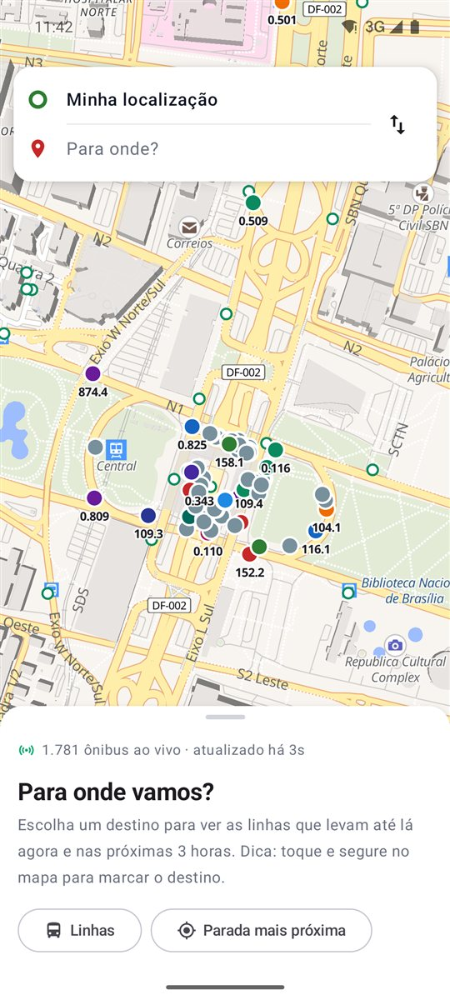
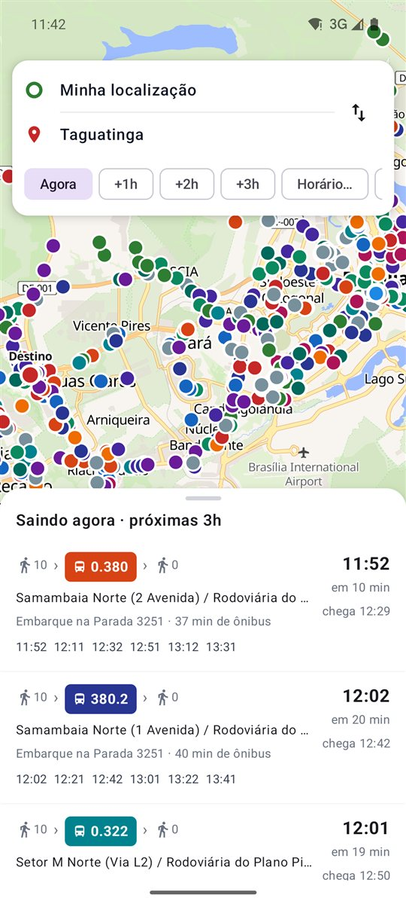
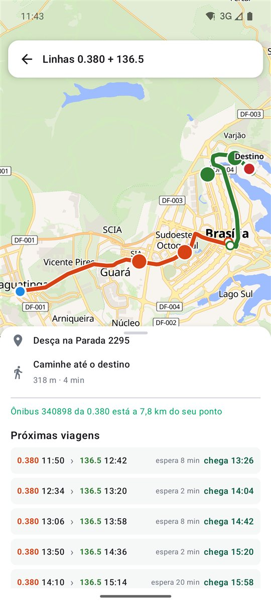
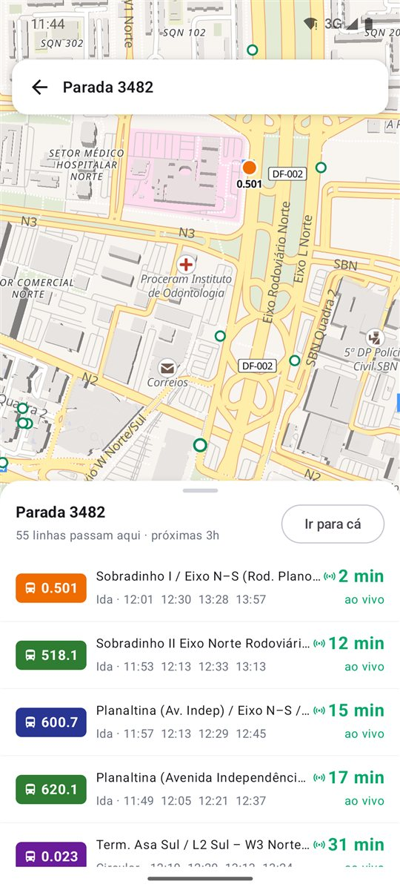
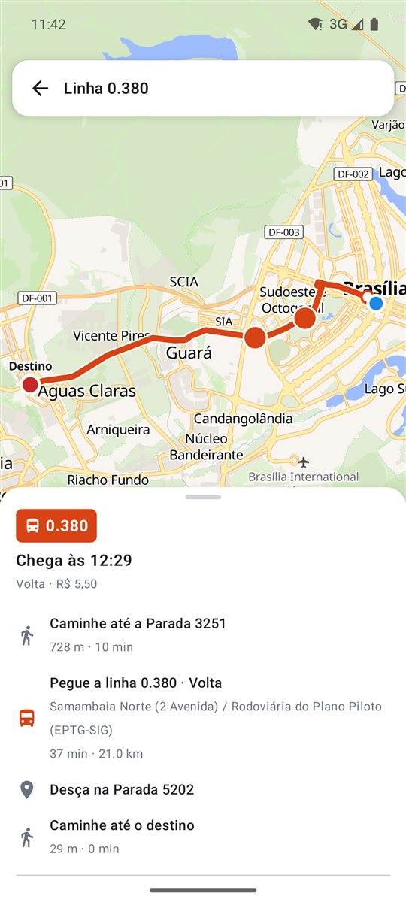
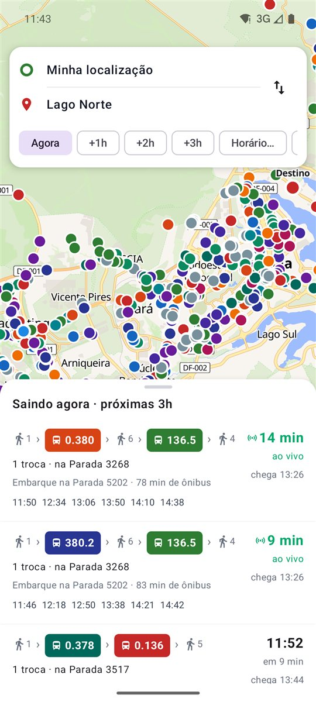

<div align="center">


# Candango

**Ônibus do Distrito Federal em tempo real.** *Can, and go — you can go.*

Veja onde está cada ônibus agora, descubra quais linhas te levam ao destino<br />
de agora até daqui a 3 horas e quanto falta para o seu chegar no ponto.

<a href="https://github.com/Mcardosor/candango/releases/latest/download/candango.apk">
  
</a>
<a href="https://mcardosor.github.io/candango/app/">
  
</a>

[Página do app](https://mcardosor.github.io/candango/) · [Todas as versões](https://github.com/Mcardosor/candango/releases) · [Como instalar](#-como-instalar)

[](https://github.com/Mcardosor/candango/actions/workflows/ci.yml)
[](https://github.com/Mcardosor/candango/releases/latest)
[](LICENSE)


</div>

<p align="center">
  
  
  
  
</p>

## ✨ O que ele faz

- **🗺️ Mapa ao vivo:** mostra a posição GPS de todos os ônibus do DF, com o número da linha, atualizada a cada 15 segundos.
- **🧭 Planejador de viagem:** você escolhe a partida e o destino (endereço, ponto no mapa ou sua localização) e vê as linhas que levam até lá, com caminhada, horários e hora de chegada.
- **⏰ Agora ou daqui a 3 horas:** os botões *Agora*, *+1h*, *+2h*, *+3h* ou um horário à sua escolha mostram o que passa nesse período.
- **🔁 Baldeação:** quando não há linha direta, ou quando trocar de ônibus chega antes, sugere combinações de duas linhas, com os horários encadeados e o tempo de espera na troca.
- **🟢 Previsão ao vivo:** "chega em 7 min", calculado pelo GPS do ônibus que está vindo para o seu ponto, e não só pela tabela.
- **🚏 Paradas:** toque numa parada para ver todas as linhas que passam ali e quanto falta para cada uma.
- **🚌 Linhas:** trajeto no mapa, paradas, ônibus rodando agora e todas as partidas do dia.

<details>
<summary><b>Mais prints</b></summary>
<p align="center">
  
  
</p>
</details>

## 📲 Como instalar

O Candango ainda não está na Play Store. A instalação é pelo arquivo APK:

1. No celular Android, toque em **[Baixar o app](https://github.com/Mcardosor/candango/releases/latest/download/candango.apk)**.
2. Abra o arquivo `candango.apk` que foi baixado.
3. Se o Android avisar sobre "fontes desconhecidas", toque em **Configurações** e ative **Permitir desta fonte**. Depois volte e toque em **Instalar**.
4. Abra o Candango e permita o acesso à localização, que é usada para achar as paradas perto de você.

Para atualizar, é só baixar e instalar a versão nova por cima: seus dados não se perdem. Requer Android 8.0 ou mais recente.

> **iPhone:** use a [versão web](https://mcardosor.github.io/candango/app/). Abra no Safari, toque em **Compartilhar** e depois em **Adicionar à Tela de Início**; o Candango fica com ícone de app. A mesma versão funciona no computador.

## 📡 De onde vêm os dados

| Dado | Fonte |
|---|---|
| Posição dos ônibus (ao vivo) | API pública da [SEMOB-DF](https://www.semob.df.gov.br/), consultada pelo app a cada 15 s |
| Linhas, paradas, trajetos e horários | Mesma API, empacotados no app por [`tools/build-data.mjs`](tools/build-data.mjs) |
| Mapa | [OpenFreeMap](https://openfreemap.org/), dados © [colaboradores do OpenStreetMap](https://www.openstreetmap.org/copyright) |
| Busca de endereços | [Photon](https://photon.komoot.io/) (komoot), dados do OpenStreetMap |

> [!IMPORTANT]
> O Candango é um projeto independente e **não é um app oficial** do GDF, da SEMOB ou das operadoras. Os horários vêm da tabela oficial, mas a hora de passagem em cada parada é **estimada** pela distância percorrida, porque a SEMOB só publica a saída do terminal. A previsão "ao vivo" depende do GPS do ônibus estar ligado.

## ⚠️ Limitações conhecidas

- **Horários estimados:** a passagem em cada parada é calculada pela distância percorrida desde o terminal. Quando a SEMOB não informa a duração da viagem, o app assume 20 km/h.
- **No máximo uma troca de ônibus:** entre os centros de 10 cidades do DF, às 9h, 80 dos 90 pares têm opção. Os demais precisariam de duas trocas.
- **Tarifa somada:** a tarifa das baldeações é a soma das linhas, sem a integração do Bilhete Único.
- **Paradas sem nome:** a API só traz o código, então elas aparecem como "Parada 3482".
- **GPS incompleto:** o GPS público cobre as Bacias 1, 3 e 5, e parte dos veículos não informa a linha.

## 🛠️ Para desenvolvedores

App nativo Android em **Kotlin + Jetpack Compose**, com mapa **MapLibre**. Não usa servidor próprio: tudo roda no celular.

```
app/src/main/java/io/github/mcardosor/candango/
├── data/
│   ├── Model.kt      # paradas, linhas, trajetos, geometria e carga do pacote offline
│   ├── Planner.kt    # planejador: diretas, baldeação, horários encadeados e ETA ao vivo
│   └── LiveApi.kt    # GPS da SEMOB e busca de endereços
├── ui/
│   ├── AppViewModel.kt
│   ├── MapController.kt
│   └── Screens.kt
└── MainActivity.kt
tools/build-data.mjs  # baixa e empacota linhas, paradas, trajetos e horários (assets/dados.json e docs/app/dados.json)
docs/                 # página de download (GitHub Pages)
└── app/              # versão web (PWA): JavaScript puro + MapLibre GL JS, sem etapa de build
    ├── js/model.js, js/planner.js, js/live.js   # mesma lógica de data/ do Android
    ├── js/map.js, js/app.js                     # mapa e telas
    └── sw.js                                    # cache para abrir rápido e sem internet
```

**Requisitos:** JDK 21 e Android SDK (compileSdk 37). Crie `local.properties` com `sdk.dir=...`, ou abra o projeto no Android Studio.

```bash
./gradlew assembleDebug          # APK de desenvolvimento
./gradlew testDebugUnitTest      # testes do planejador com os dados reais
node tools/build-data.mjs        # atualiza linhas e horários da SEMOB (~30 s)
```

**Versão web:** é servida direto de `docs/` pelo GitHub Pages; um push na `main` publica. Para testar localmente, sirva a pasta `docs/` com qualquer servidor estático e abra `/app/` (em `localhost`, `?geo=-15.7962,-47.8838` simula a sua localização e o service worker fica desligado). Ao mudar arquivos do app web, troque a versão em `CACHE` no `docs/app/sw.js`.

**Publicar uma versão:** atualize `versionCode` e `versionName` em `app/build.gradle.kts` e crie uma tag `vX.Y.Z`. O GitHub Actions compila, assina e publica o APK em [Releases](https://github.com/Mcardosor/candango/releases).

Contribuições são bem-vindas. Leia o [guia de contribuição](CONTRIBUTING.md).

## 📄 Licença

© Matheus Cardoso Rodrigues. Todos os direitos reservados; veja [LICENSE](LICENSE). Os dados de transporte pertencem à SEMOB-DF, e os dados de mapa ao OpenStreetMap ([ODbL](https://opendatacommons.org/licenses/odbl/)).
